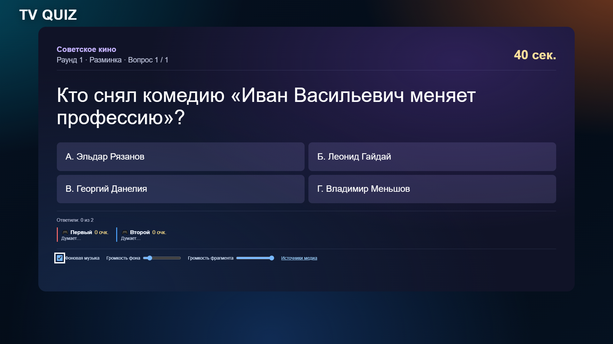
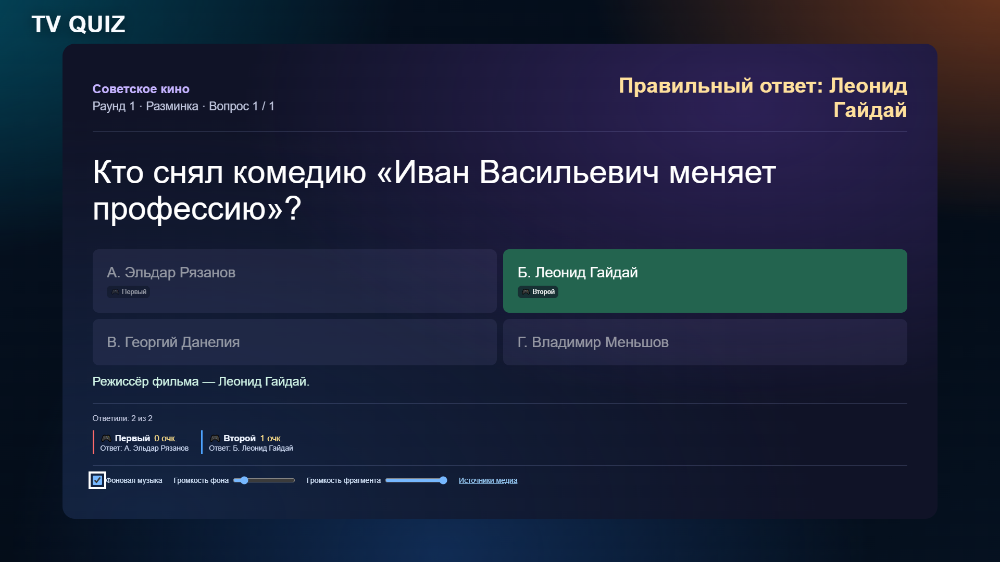
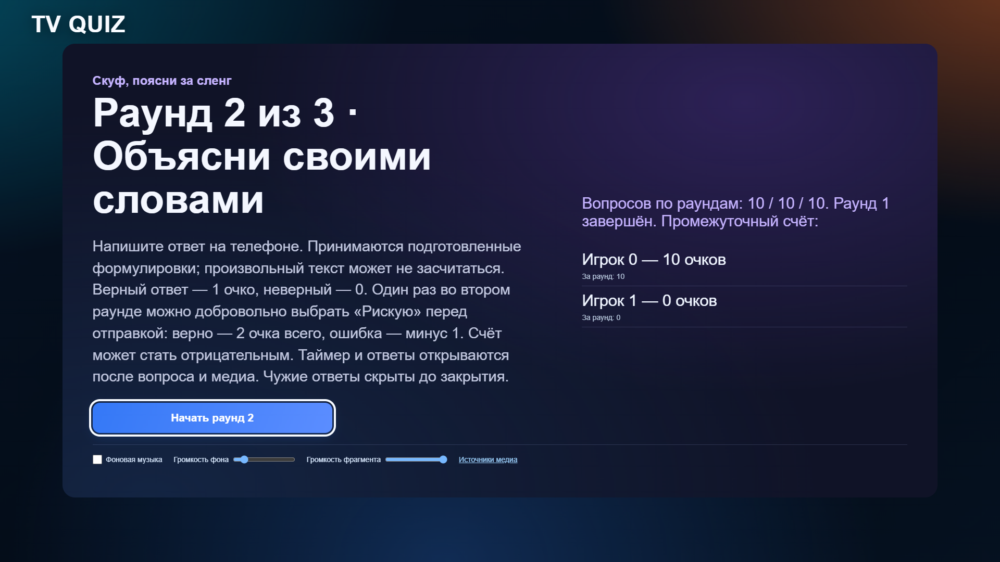
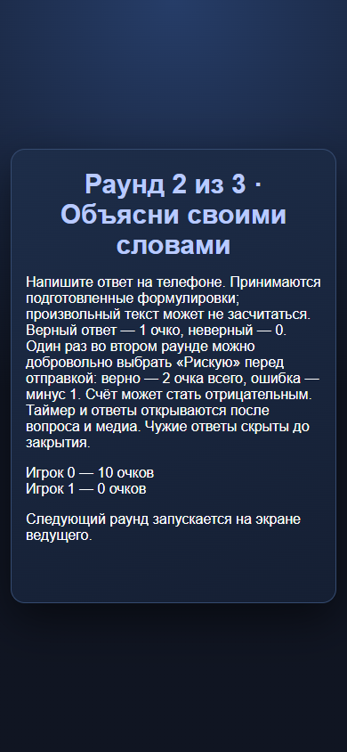

# Три раунда из каталога

Работа по #3, #4, #6, #7, #11, #13 и #33, включая уточнения Игоря 17–21 ноября. SpeechKit остаётся на паузе в #34.

## Почему раундов не было

В main f0d9ddc обычная карточка вызывала ветку `makeDeck`, которая выбирала максимум 10 вопросов и присваивала всем `roundIndex: 0`. Только специальные квизы использовали массив `rounds`. Причём их раунды обрезались до длины самого короткого. В браузере проверен именно опубликованный каталог: первая карточка «Легенды рока» → QR → колода из 10 вопросов, единственный индекс раунда 0. Скрипт воспроизведения: `scripts/inspect_published_rounds.cjs`.

## Поведение

- Прямой запуск карточка → QR сохранён. Карточка и лобби показывают реальные размеры трёх раундов. Каждый доступный уровень имеет три непустых раунда; неполные наборы обозначены как пилоты.
- Первые два раунда обычных карточек используют существующие вопросы с выбором вариантов той же темы и сложности. Они распределяются без повторов; вопросы не подменяются свободным вводом.
- Финалы заданы явно в `round-plans.js`: музыка — подсказки, кино — ситуация/сюжет, автомобили — правда/вымысел, география/наука — числовая оценка. 60 уникальных заданий в десяти тематических банках (по 6, выбираются 4); тематические карточки могут использовать один подготовленный набор. Музыкальные текстовые карточки не объявляются полноценным аудиоквизом.
- Сленг сохраняет выбор значения → подготовленный свободный ввод → переписку. Звуки сохраняют выбор → ввод → трёхсекундный фрагмент. Аббревиатуры и медиапредпросмотр сохраняют свои сценарии. «Кто ближе?» играет 4 / 3 / 3 без ставки, финал выбирается из 7 заданий. Финальные банки сленга расширены до 12, звуков/аббревиатур/медиапредпросмотра — до 7. При повторной игре состав финала обязательно меняется, даже если случайный выбор повторился; первые два раунда сохраняют содержание и тип.
- Перед каждым раундом есть правила и кнопка запуска с пульта. Перед вторым и третьим — общий счёт и прирост за завершённый раунд. После третьего — итог. «Сыграть ещё раз» сохраняет комнату, возвращает готовность игроков, обнуляет счёт и ставку.
- Таймер 40/30/20/15 масштабируется отдельно по фактической длине каждого раунда; свободный ввод получает ещё 10 секунд. Голосовые вызовы и ожидания удалены. Приём начинается после показа вопроса и завершения медиа. Короткий клип включается явным свойством аудиораунда, а не у любого третьего раунда.
- Ставка добровольная, только раунд 2 с разрешённой механикой, один раз: +2 всего / −1. В числовой механике запрещена и интерфейсом, и моделью.
- До закрытия скрыты выбранные варианты, плашки голосов и ставки. Повторное раскрытие не начисляет очки; закрытое окно не может открыться повторным событием окончания клипа.

## Контент и пробелы

Полная таблица всех уровней: [round-coverage.md](round-coverage.md). Только сленг имеет 10 / 10 / 10. Звуки, аббревиатуры и медиапредпросмотр — по 5 / 5 / 5. Обычные финалы используют 4 задания из 6, а первые два раунда зависят от пригодного банка уровня. Это работающая механика трёх раундов, не завершённое наполнение всех квизов на 30 вопросов. Цель 25–35 минут не измерена, пустые паузы ради неё не добавлены.

Опубликованный `questions.js` и браузер подтвердили ошибку Oasis: «Барабаны» вместо Манчестера. Исправлены три проверенных ключа (Oasis, сага Хана Соло, актёр Индианы Джонса) и вариант города. Источники: [Oasis](https://www.oasisinet.com/the-story/), [Han Solo](https://www.starwars.com/databank/han-solo), [Lucasfilm](https://www.lucasfilm.com/productions/indiana-jones-and-the-last-crusade/).

Отдельный явный список `content/question-exclusions.json` исключает из партий 41 повреждённую запись, 12 смысловых повторов и 2 неточные/неоднозначные формулировки. Все исходные 336 записей сохранены; правильные версии вопросов остаются, если повреждённая версия исключена. Это просмотр согласованности вопроса, ключа и пояснения, а не полная внешняя фактологическая проверка 336 записей. Редакторская сверка оставшегося банка и заполнение пробелов относятся к #11/#5.

Новые финальные вопросы содержат ссылки на источники, математические задачи — полностью заданные условия и расчёт в пояснении. Существующие аудиофайлы в assets/quiz-media не менялись; их происхождение и статус проверки остаются в `content/audio-pilot/README.md` и `content/media-pack`.

## Новые лицензированные медиа и управление

Добавлены две музыкальные нарезки Kevin MacLeod (CC BY 4.0), два видео Blender Foundation (CC BY 3.0), отдельная 32-секундная фоновая нарезка Carefree без вокала. Общий размер — около 1,9 МБ. Источники, авторы, границы нарезки и изменения: [media-credits.html](../media-credits.html); точные ссылки загрузки, размер и SHA-256: [content/licensed-media.json](../content/licensed-media.json). Полные исходники в репозиторий не добавляются. Открытая лицензия новых файлов не распространяется на прежние магазинные превью.

Под игровым полем доступны включение/выключение фона и отдельные регуляторы фона/фрагмента, включая стрелки со старыми кодами LG. Во время задания с медиа фон заглушается. При недоступности записи остаётся исходный синтезированный фон. Ведущая страница не вызывает голосовой синтез. Ссылки и правильные ответы не передаются на телефон до раскрытия. Источники новых медиа доступны из игрового экрана и пояснения после ответа.

## Проверка

`node scripts/test_three_rounds.cjs` — Edge, ведущий 1920×1080 и два клиента 390×844, настоящий код HTTPS-транспорта и Worker с SQLite через локальный HTTP. CDN QR заменён явно; озвучка выключена. Время ожиданий ускорено тестовыми часами, аудиофайлы декодируются браузером с ускоренным воспроизведением. Это не измерение длительности и не проверка качества звука на устройствах.

Проверяются все доступные колоды/числа/сбросы таймера и полные партии сленга, музыки, автомобилей, географии, аббревиатур, медиапредпросмотра, звуков и «Кто ближе?». В партиях: обе границы раундов, правила/промежуточные суммы, правильные и неверные ответы, +2/−1 и однократный расход, скрытие голосов, повторный пакет/раскрытие, таймер после клипа, числовые ничьи и итог. Сленг дополнительно проходит запуск новой партии в той же комнате.

`TV_TEST_MEDIA_FAILURE=1 TV_TEST_QUIZZES=audio-recognition` проверяет ошибку первого клипа: пропуск без очков/ставки и открытие ответов после следующего настоящего клипа. `TV_TEST_COVERAGE_ONLY=1` обновляет отчёт колод без повторения партий. Файлы проверки сохраняются в `TV_TEST_ARTIFACTS` или временный `tvquiz-rounds`.

`scripts/test_tv_navigation.cjs` проверяет каталог 1080p/4K/390px, фокус/стрелки/Enter/коды LG/Назад, прямой запуск всех 60 карточек и автоматические таймеры. Это браузерная проверка, не физический пульт LG или iPhone. Содержательные проверки, существующие валидаторы, синтаксис и diff-check указаны в PR с фактическим результатом.

## Игровой экран и каталог

Постоянная верхняя строка показывает название квиза, раунд, номер вопроса и время. В центре — крупный вопрос и варианты, изображения и видео располагаются рядом с вопросом на широком экране. Состояние игроков и звук находятся внизу. Экраны между раундами и итоги используют общий фон и отдельную колонку счёта. Для каждого из 25 квизов используется собственная сцена, для уровней одного квиза меняются кадрирование и графика поверх изображения. [Обложки и запросы ImageGen](../assets/catalog/README.md).

### Браузерные прогоны 21 ноября

Два узких браузерных клиента и ведущий Edge. Первый игрок отвечал правильно, второй ошибался, в числовых вопросах оба указывали правильное значение.

| Набор | Вопросов | Итог |
|---|---:|---|
| Легенды рока, лёгкий | 13 | 14 / −1 |
| Марки и модели, лёгкий | 13 | 14 / −1 |
| Страны и столицы, лёгкий | 13 | 14 / 3 |
| Аббревиатуры | 15 | 16 / −1 |
| Сленг | 30 | 31 / −1, новая партия в той же комнате |
| Откуда этот звук? | 15 | 16 / −1 |
| Предпросмотр медиапакета | 15 | 16 / −1 |
| Кто ближе? | 10 | 10 / 10, два прогона |

В предыдущем прогоне кнопка отправки стала недоступна на последнем числовом вопросе. В двух новых прогонах оба игрока отправили ответ на этот вопрос, причина прежнего сбоя осталась неизвестна. Тест теперь сверяет текст открывшегося вопроса и при сбое записывает номер, состояние кнопки и оставшееся время.

Медиапредпросмотр прошёл прежний проблемный вопрос auto-i02. Тестовый сервер отдаёт SVG с правильным MIME. Отдельные проверки воспроизвели четыре новых файла и фон и подтвердили громкость, отсутствие вызовов речи, таймер после клипа, пропуск ошибки без очков и защиту от позднего ended.

### Открытые задачи

| Issue или PR | Что покрыто и что остаётся |
|---|---|
| #1 | Общая модель медиа, пользовательский редактор и игра «Кто ближе?» уже существуют. Расширение медиараундов по темам остаётся в плане. |
| #3, #6 | Смена финала, таймер и ставка проверены в браузере. Нужна проверка с физическими телефонами. |
| #4, #34 | Фон и эффекты работают. Голос и платный синтез на паузе. Длительность полной игры на устройствах пока не измерена. |
| #5, #11 | Есть пилоты и исправления ключей. Остаются полный редакторский разбор источников и наполнение уровней. |
| #7, #13, #15 | Звуковой квиз и медиапредпросмотр работают как пилоты. Остались новые категории звуков, медиабанки обычных музыкальных и киноквизов, пользовательское прослушивание и проверка прав ранее собранных записей. |
| #27, #30, #33 | Каталог и QR уже работают на Pages по результатам #32. Эта ветка обновляет обложки и игровой экран. Нужна проверка на LG и iPhone. #30 содержит отдельный макет каталога для рассмотрения. |
| #28 | «Исковерканные слова» остаются самостоятельной следующей задачей. Карточка и банк этого квиза ещё отсутствуют. |

QR из запуска ведущего через file: декодирован и проверен 21.11. Два клиента подключились через публичный HTTPS-сервер, подтвердили готовность и ответили. Счёт 0 / 1. Один клиент использовал текущую Pages, второй — локальную ветку. Проверка восстановления телефонного соединения также прошла.

Изменение затрагивает критический игровой поток и счёт. PR не объединяется без подтверждения Игоря; сайт обновится только после merge и отдельной проверки Pages.
